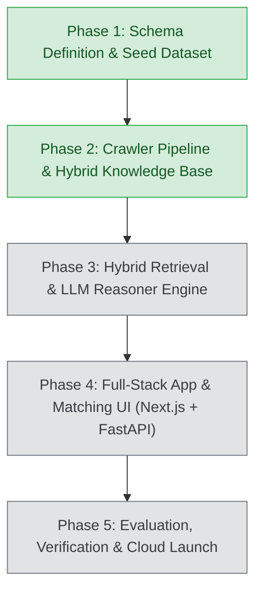

# Government Schemes Discovery & RAG Platform

An enterprise-grade, retrieval-augmented AI platform that matches businesses (MSMEs, Startups, Sole Proprietors, Large Enterprises) with central and state government schemes, subsidies, grants, and credit facilities.

---

## 1. Roadmap & Architecture Status



| Phase | Milestone | Status | Key Deliverables |
| :--- | :--- | :--- | :--- |
| **Phase 1** | Schema Definition & Seed Dataset | ✅ Complete | Pydantic Schemas (`BusinessProfile`, `GovernmentScheme`), 30 Flagship Seed Schemes, GST REG-06 Multimodal Parser, Stage 1 Deterministic Engine. |
| **Phase 2** | Crawler Pipeline & Knowledge Base Construction | ✅ Complete | Multi-portal Scrapers (MSME, Startup India, Jan Samarth, MyScheme), PDF Guideline Ingestion Engine, SQLite Knowledge Store, Dense Vector Index, `pipeline.py` CLI. |
| **Phase 3** | Hybrid Retrieval & Reasoner Engine | ⏳ Next | Cross-Encoder Reranker, LLM Eligibility Verification & Document Gap Analysis Synthesis. |
| **Phase 4** | Full-Stack App & Matching UI | ⏳ Planned | Next.js 14 Document Upload Dashboard + FastAPI Backend. |
| **Phase 5** | Guardrails, Testing & Launch | ⏳ Planned | Hallucination Guardrails, PII Masking, Production Deployment. |

---

## 2. Directory Structure

```text
government-schemes-rag/
├── docs/                         # Project architecture & phase implementation plans
│   ├── government-schemes-rag-plan.md  # Original Architectural Blueprint
│   └── phase-2-implementation-plan.md  # Phase 2 Detailed Architecture & Design
├── pipeline.py                   # Unified Phase 2 Pipeline Runner (Crawl, Ingest, Index, Search, Stats)
├── cli.py                        # Interactive CLI demo for Phase 1
├── requirements.txt              # Core project dependencies
├── README.md                     # Architecture and operational documentation
├── crawlers/                     # Multi-source scraper modules
│   ├── __init__.py
│   ├── base.py                   # BaseSchemeCrawler (Rate limiting, retries, dual live/offline fixture mode)
│   ├── msme_crawler.py           # MSME & DC-MSME portal scraper (ZED, PMS, Innovative, PMFME)
│   ├── startup_india_crawler.py  # Startup India scraper (SISFS, Section 80-IAC, CGSS, SAMRIDH)
│   ├── jansamarth_crawler.py     # Jan Samarth credit scraper (PMEGP, Mudra, Stand-Up India, CGTMSE)
│   └── myscheme_crawler.py       # MyScheme unified central & state scraper (CMEGP-MH, PLI, SPECS)
├── parsers/
│   ├── __init__.py
│   ├── gst_parser.py             # Form GST REG-06 Multimodal Prompt & text parser
│   └── pdf_guidelines_parser.py  # PDF guidelines parser (Text chunking, eligibility & subsidy extraction)
├── knowledge_base/               # Persistent storage & hybrid search engine
│   ├── __init__.py
│   ├── storage.py                # SQLite Knowledge Store (schemes, scheme_documents, crawl_history)
│   ├── normalizer.py             # Schema normalizer & deduplicator against GovernmentScheme model
│   └── vector_store.py           # Dense TF-IDF / Cosine Vector Store + metadata pre-filtering
├── schemas/
│   ├── __init__.py
│   ├── business_profile.py       # Pydantic model for BusinessProfile (GST/Udyam digital twin)
│   └── government_scheme.py      # Authoritative Pydantic model for GovernmentScheme
├── engine/
│   ├── __init__.py
│   └── matcher.py                # Stage 1 Deterministic Pre-Filtering Engine
├── data/
│   ├── gst_state_codes.json      # GSTIN 2-digit state code mapping (01 to 38)
│   ├── schemes_seed.json         # 30 curated flagship schemes golden benchmark
│   ├── schemes_knowledge.db      # SQLite relational database (schemes + chunks + crawl history)
│   └── schemes_vector_index.json # Dense vector index and vocabulary
├── samples/
│   ├── sample_gst_certificates.json # Mock GST certificates for diverse sectors/states
│   ├── create_sample_pdfs.py     # Sample PDF guidelines generator
│   └── guidelines/               # Generated test guideline circulars (PMEGP, ZED)
└── tests/
    ├── test_phase1.py            # Automated tests for Phase 1 schemas and deterministic matcher
    └── test_phase2.py            # Automated tests for Phase 2 crawlers, PDF parser, SQLite, & Vector Store
```

---

## 3. Phase 2 Features & Components

### 3.1 Multi-Source Crawlers (`crawlers/`)
- **Resilient Dual-Mode Design**: Each crawler supports live web scraping with exponential backoff and polite rate-limiting, and seamlessly falls back to realistic snapshot fixtures in offline or firewall-restricted environments.
- **Portals Scraped**:
  - `msme.gov.in` & `dcmsme.gov.in`: ZED certification (80% fee subsidy), MSME Innovative Scheme, PMS stall charge reimbursement, PMFME micro food units.
  - `startupindia.gov.in`: SISFS (₹50 Lakh seed funding), Section 80-IAC (3-year 100% tax holiday), CGSS (₹10 Cr guarantee), MeitY SAMRIDH.
  - `jansamarth.in`: CGTMSE (₹5 Cr collateral-free credit), PMEGP (35% margin money subsidy), Stand-Up India (greenfield loans ₹10 Lakh to ₹1 Cr), PMMY Mudra (Shishu, Kishore, Tarun).
  - `myscheme.gov.in`: Maharashtra CMEGP (35% subsidy up to ₹50 Lakh), PLI for Large Scale Electronics (4%-6% sales incentive), SPECS (25% capex grant).

### 3.2 PDF Scheme Guidelines Ingestion (`parsers/pdf_guidelines_parser.py`)
- Reads official operational guideline circulars (PDFs).
- Extracts sections: Policy Objectives, Qualifying Criteria, Subsidy Quantum, and Mandatory Document Checklist.
- Automatically generates overlapping text chunks with page numbers and section headers for vector search citations.

### 3.3 Relational Knowledge Store (`knowledge_base/storage.py`)
- **SQLite Database** (`data/schemes_knowledge.db`) with relational tables:
  - `schemes`: Full JSON payload + indexed columns (jurisdiction, benefit_type, status, etc.).
  - `scheme_documents`: Chunked text passages linked to parent schemes.
  - `crawl_history`: Audit records tracking crawl status, timestamps, and scheme counts.

### 3.4 Hybrid Vector Store (`knowledge_base/vector_store.py`)
- Combines **Stage 1 Deterministic Metadata Filtering** (State, Constitution, MSME Tier, Manufacturing affirmative rules) with **Stage 2 Dense Semantic Search** (n-gram subword TF-IDF Cosine Similarity).
- Pluggable architecture ready for Gemini Embeddings (`text-embedding-004`).

---

## 4. Quickstart & Verification

### Run the Automated Test Suites
```powershell
cd C:\Users\yadav\.gemini\antigravity\scratch\government-schemes-rag

# Run Phase 1 Tests (6 tests)
python tests/test_phase1.py

# Run Phase 2 Tests (9 tests)
python tests/test_phase2.py
```
*Expected Result: `OK` on all tests.*

### Running the Phase 2 Pipeline CLI

#### 1. Populate Knowledge Base
```powershell
# Ingest Phase 1 30 seed schemes into SQLite
python pipeline.py --load-seed

# Run scrapers across all government portals
python pipeline.py --crawl all --offline

# Ingest and chunk official PDF guidelines
python pipeline.py --ingest-pdf samples/guidelines/pmegp_guidelines.pdf --scheme-id pmegp
python pipeline.py --ingest-pdf samples/guidelines/zed_guidelines.pdf --scheme-id zed

# Rebuild the dense semantic vector index
python pipeline.py --build-index
```

#### 2. Inspect Knowledge Base Statistics
```powershell
python pipeline.py --stats
```

#### 3. Execute Hybrid Semantic Searches
```powershell
# Search for startup grants and prototype funding
python pipeline.py --query "early stage seed fund grant prototype proof of concept" --top-k 3

# Search for collateral-free bank loans for a Sole Proprietorship
python pipeline.py --query "collateral free credit guarantee working capital" --entity "Proprietorship" --top-k 3

# Search for state-specific employment subsidy in Maharashtra
python pipeline.py --query "employment generation margin money subsidy" --state "Maharashtra" --top-k 3
```

---

## 5. Next Steps: Phase 3
Phase 2 establishes the crawling, PDF guideline chunking, SQLite storage, and hybrid vector indexing infrastructure. We are ready to begin **Phase 3: Hybrid Retrieval & LLM Reasoner Engine** (integrating Cross-Encoder reranking and grounded LLM eligibility synthesis).
