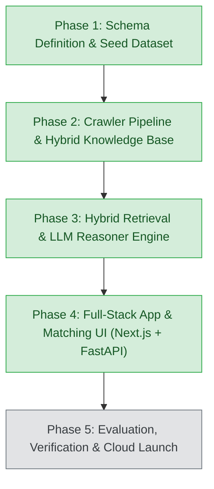

# Government Schemes Discovery & RAG Platform

An enterprise-grade, retrieval-augmented AI platform that matches businesses (MSMEs, Startups, Sole Proprietors, Large Enterprises) with central and state government schemes, subsidies, grants, and credit facilities.

---

## 1. Roadmap & Architecture Status



| Phase | Milestone | Status | Key Deliverables |
| :--- | :--- | :--- | :--- |
| **Phase 1** | Schema Definition & Seed Dataset | ✅ Complete | Pydantic Schemas (`BusinessProfile`, `GovernmentScheme`), 30 Flagship Seed Schemes, GST REG-06 Multimodal Parser, Stage 1 Deterministic Engine. |
| **Phase 2** | Crawler Pipeline & Knowledge Base Construction | ✅ Complete | Multi-portal Scrapers (MSME, Startup India, Jan Samarth, MyScheme), PDF Guideline Ingestion Engine, SQLite Knowledge Store, Dense Vector Index, `pipeline.py` CLI. |
| **Phase 3** | Hybrid Retrieval & Reasoner Engine | ✅ Complete | Reciprocal Rank Fusion (RRF), Cross-Encoder Reranker, LLM Eligibility Verification & Regulatory Document Gap Analysis Synthesizer. |
| **Phase 4** | Full-Stack App & Matching UI | ✅ Complete | FastAPI REST Backend Service, Interactive Single-Page Matching Dashboard, Next.js 14 App Router Client, Grounded Policy Copilot Chat. |
| **Phase 5** | Guardrails, Testing & Launch | ⏳ Next | Hallucination Guardrails, PII Masking, Production Deployment. |

---

## 2. Directory Structure

```text
government-schemes-rag/
├── api/                          # Phase 4: FastAPI REST API & Web Dashboard Service
│   ├── __init__.py
│   ├── main.py                   # FastAPI Application Entrypoint & Static Route Mounter
│   ├── dependencies.py           # Dependency injection providers for Stores and Reasoner
│   ├── routes/
│   │   ├── __init__.py
│   │   ├── upload.py             # Document Upload (PDF/Image) & Digital Twin Extractor
│   │   ├── schemes.py            # Schemes Knowledge Base Browsing, Details, & Semantic Search
│   │   ├── reasoner.py           # End-to-End Deliberation & Markdown Export Endpoints
│   │   ├── chat.py               # Grounded Policy Copilot Conversational Chat Endpoint
│   │   └── stats.py              # Knowledge Base Relational Metrics Endpoint
│   └── static/
│       └── index.html            # Interactive Modern Web Dashboard (Zero-install instant browser UI)
├── frontend/                     # Phase 4: Modern Next.js 14 App Router Frontend
│   ├── package.json              # Next.js 14, React 18, Tailwind CSS, Lucide dependencies
│   ├── tsconfig.json             # TypeScript configuration
│   ├── next.config.js            # Next.js configuration with FastAPI proxy rewrites
│   ├── tailwind.config.js        # Tricolor & Indian Gov theme styling
│   └── src/
│       ├── app/
│       │   ├── layout.tsx        # Responsive root layout with tricolor accent
│       │   ├── page.tsx          # Interactive Document Upload, Digital Twin Card, & Deliberation Cards
│       │   └── globals.css       # Tailwind CSS base styles
│       └── lib/
│           ├── types.ts          # TypeScript interfaces matching Python Pydantic models
│           └── api.ts            # Typed client SDK calling FastAPI endpoints
├── pipeline.py                   # Unified Pipeline Runner (Crawl, Ingest, Index, Search, Phase 3 Reasoner, Server)
├── cli.py                        # Interactive CLI demo for Phase 1 & Phase 3
├── requirements.txt              # Core project dependencies
├── README.md                     # Architecture and operational documentation
├── crawlers/                     # Multi-source scraper modules
│   ├── __init__.py
│   ├── base.py                   # BaseSchemeCrawler (Rate limiting, retries, dual live/offline fixture mode)
│   ├── msme_crawler.py           # MSME & DC-MSME portal scraper (ZED, PMS, Innovative, PMFME)
│   ├── startup_india_crawler.py  # Startup India scraper (SISFS, Section 80-IAC, CGSS, SAMRIDH)
│   ├── jansamarth_crawler.py     # Jan Samarth credit scraper (PMEGP, Mudra, Stand-Up India, CGTMSE)
│   └── myscheme_crawler.py       # MyScheme unified central & state scraper (CMEGP-MH, PLI, SPECS)
├── parsers/
│   ├── __init__.py
│   ├── gst_parser.py             # Form GST REG-06 Multimodal Prompt & text parser
│   └── pdf_guidelines_parser.py  # PDF guidelines parser (Text chunking, eligibility & subsidy extraction)
├── knowledge_base/               # Persistent storage & hybrid search engine
│   ├── __init__.py
│   ├── storage.py                # SQLite Knowledge Store (schemes, scheme_documents, crawl_history)
│   ├── normalizer.py             # Schema normalizer & deduplicator against GovernmentScheme model
│   └── vector_store.py           # Dense TF-IDF / Cosine Vector Store + metadata pre-filtering
├── schemas/
│   ├── __init__.py
│   ├── business_profile.py       # Pydantic model for BusinessProfile (GST/Udyam digital twin)
│   ├── government_scheme.py      # Authoritative Pydantic model for GovernmentScheme
│   └── reasoner_schema.py        # Phase 3 schemas: DocumentGapItem, ClauseCitation, FullReasoningReport
├── engine/
│   ├── __init__.py
│   ├── matcher.py                # Stage 1 Deterministic Pre-Filtering Engine
│   ├── retriever.py              # Stage 2 Hybrid Multi-Channel Retriever with Reciprocal Rank Fusion (RRF)
│   ├── reranker.py               # Stage 2.5 Cross-Encoder Contextual Reranker with explainable factors
│   ├── reasoner.py               # Stage 3 LLM Eligibility Verifier & Document Gap Analysis Synthesizer
│   └── pipeline_phase3.py        # Unified Phase 3 Orchestrator & Report Generator
├── data/
│   ├── gst_state_codes.json      # GSTIN 2-digit state code mapping (01 to 38)
│   ├── schemes_seed.json         # 30 curated flagship schemes golden benchmark
│   ├── schemes_knowledge.db      # SQLite relational database (schemes + chunks + crawl history)
│   └── schemes_vector_index.json # Dense vector index and vocabulary
├── samples/
│   ├── sample_gst_certificates.json # Mock GST certificates for diverse sectors/states
│   ├── sample_1_report.md        # Sample generated Markdown gap analysis report
│   ├── create_sample_pdfs.py     # Sample PDF guidelines generator
│   └── guidelines/               # Generated test guideline circulars (PMEGP, ZED)
└── tests/
    ├── test_phase1.py            # Automated tests for Phase 1 schemas and deterministic matcher (6 tests)
    ├── test_phase2.py            # Automated tests for Phase 2 crawlers, PDF parser, SQLite, & Vector Store (9 tests)
    ├── test_phase3.py            # Automated tests for Phase 3 Hybrid RRF, Cross-Encoder, & Reasoner (8 tests)
    └── test_phase4.py            # Automated tests for Phase 4 FastAPI Endpoints & UI Serving (10 tests)
```

---

## 3. Phase 4 Features & API Endpoints

### 3.1 FastAPI REST Backend (`api/`)
The FastAPI server provides high-throughput, asynchronous endpoints with OpenAPI documentation (`/docs`):

| Endpoint | Method | Description |
| :--- | :--- | :--- |
| `GET /` | `GET` | Serves the interactive Web Dashboard SPA with zero external build requirements. |
| `GET /health` | `GET` | Health check reporting database and vector store connectivity. |
| `GET /api/stats` | `GET` | Aggregated metrics: scheme counts, benefit categories, crawler audit logs. |
| `GET /api/schemes` | `GET` | Browse schemes with SQL filters (`jurisdiction`, `state`, `benefit_type`, `search`). |
| `GET /api/schemes/{id}`| `GET` | Retrieve full scheme rules, benefits, and ingested guideline PDF text chunks. |
| `POST /api/schemes/search` | `POST` | Hybrid semantic vector search with state and entity pre-filters. |
| `GET /api/sample-profiles` | `GET` | List metadata for pre-configured 1-click test profiles (Tech, Food, Textile). |
| `POST /api/sample-profile/{id}` | `POST` | Load normalized `BusinessProfile` for instant evaluation. |
| `POST /api/upload-document` | `POST` | Ingest Form GST REG-06 or Udyam PDF/images and extract structured profile. |
| `POST /api/schemes/deliberate` | `POST` | Run Phase 3 Reasoner pipeline: RRF Retrieval -> Cross-Encoder -> Gap Analysis. |
| `POST /api/schemes/export-markdown` | `POST` | Download synthesized eligibility report as formatted GitHub Markdown. |
| `POST /api/chat` | `POST` | Grounded Policy Copilot conversational assistant citing official circulars. |

### 3.2 Interactive Web Matching Dashboard (`api/static/index.html`)
- **Document Drag-and-Drop Dropzone**: Ingests GST REG-06 PDFs or images with in-memory parsing.
- **One-Click Quick Test Buttons**:
  - *Sample 1*: Electronics Pvt Ltd (Woman Co-founder, DPIIT recognized, Pune MH).
  - *Sample 2*: Food Processing Micro-Unit (Proprietorship, Anand Gujarat).
  - *Sample 3*: Textile & Garment Manufacturing LLP (Peenya, Karnataka).
- **Interactive Business Profile Digital Twin Card**: Edit legal name, GSTIN, constitution, turnover bracket slider, and affirmative checkboxes (Woman-owned, DPIIT Startup, SC/ST promoter).
- **Ranked Scheme Recommendation Cards**:
  - Color-coded Verdict Badges (🟢 `Eligible`, 🟡 `Conditionally Eligible`, 🔴 `Ineligible`).
  - Match Score Progress Indicator (`87/100`) + Model Confidence (`90%`).
  - Financial Benefit Package Highlight (exact subsidy % and monetary cap estimation).
  - Pass/Fail Criteria Checklist.
  - Interactive **Document Compliance Audit Accordion**: Audits 11 official regulatory documents with status (`Available`, `Missing`, `Action Required`), issuing authorities (Udyam, CA, SPCB, Tehsildar), and SLA days.
  - Official Guideline Circular Grounding Citations box.
  - 4-Step Application Roadmap.
- **Policy Copilot (AI Chat Assistant)**: Ask questions regarding margin money subsidies, collateral requirements, or application portals with cited policy badges.

### 3.3 Next.js 14 App Router Frontend (`frontend/`)
- Modern React 18 & TypeScript frontend with Tailwind CSS and Lucide icons.
- Built-in API proxy rewrites pointing to `http://localhost:8000/api/*`.
- Reusable components: `DocumentUpload`, `ProfileConfirmation`, `SchemeCard`, `PolicyCopilotChat`.

---

## 4. Quickstart & Verification

### Run All 33 Automated Tests Across All Phases
```powershell
python -m unittest discover tests
```
*Expected Result: `Ran 33 tests in ~1.5s - OK` (Phase 1: 6, Phase 2: 9, Phase 3: 8, Phase 4: 10).*

### Start the Full-Stack Platform Server
```powershell
# Option A: Via Unified Pipeline CLI
python pipeline.py --serve --port 8000

# Option B: Via Uvicorn module
python -m uvicorn api.main:app --host 0.0.0.0 --port 8000 --reload
```
- **Web Dashboard**: Open [http://localhost:8000](http://localhost:8000) in any browser.
- **Interactive API Documentation (Swagger)**: [http://localhost:8000/docs](http://localhost:8000/docs)
- **Alternative ReDoc UI**: [http://localhost:8000/redoc](http://localhost:8000/redoc)

### (Optional) Run the Next.js 14 Frontend Dev Server
```powershell
cd frontend
npm install
npm run dev
```
Open [http://localhost:3000](http://localhost:3000) in your browser.

---

## 5. Next Steps: Phase 5
With Phase 4 complete, the end-to-end full-stack platform (FastAPI REST service, interactive matching dashboard, and Next.js frontend) is active. We are now ready for **Phase 5: Evaluation, Verification & Cloud Launch** (hallucination evaluation benchmarks, PII sanitization guardrails, and production cloud containerization).
