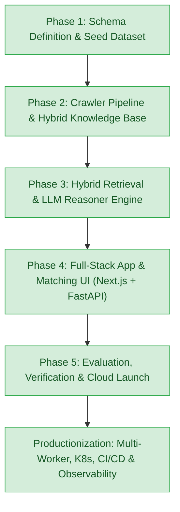
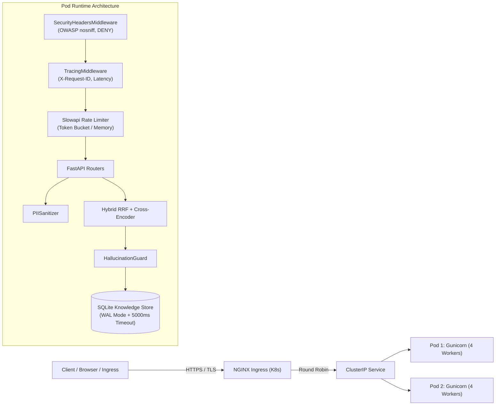

# Government Schemes Discovery & RAG Platform

An enterprise-grade, retrieval-augmented AI platform that matches Indian businesses (MSMEs, Startups, Sole Proprietors, Large Enterprises) with central and state government schemes, subsidies, grants, and credit facilities.

---

## 1. Roadmap & Architecture Status



| Milestone | Status | Key Deliverables |
| :--- | :--- | :--- |
| **Phase 1: Schema & Rules** | ✅ Complete | Pydantic Schemas (`BusinessProfile`, `GovernmentScheme`), 30 Flagship Seed Schemes, GST REG-06 Multimodal Parser, Stage 1 Deterministic Engine. |
| **Phase 2: Crawlers & Stores** | ✅ Complete | Multi-portal Scrapers (MSME, Startup India, Jan Samarth, MyScheme), PDF Guideline Ingestion Engine, SQLite Knowledge Store, Dense Vector Index, `pipeline.py` CLI. |
| **Phase 3: Hybrid RAG Reasoner** | ✅ Complete | Reciprocal Rank Fusion (RRF), Cross-Encoder Reranker, LLM Eligibility Verification & Regulatory Document Gap Analysis Synthesizer. |
| **Phase 4: App & Dashboard** | ✅ Complete | FastAPI REST Backend Service, Interactive Single-Page Matching Dashboard, Next.js 14 App Router Client, Grounded Policy Copilot Chat. |
| **Phase 5: Guardrails & Benchmarks**| ✅ Complete | Hallucination Guardrails, PII Sanitization, Golden Benchmark Suite, Multi-Stage Dockerfile & Compose orchestration. |
| **Productionization E2E** | ✅ Complete | Centralized Pydantic Settings, OWASP Security Headers, Request-ID Tracing, Slowapi Rate Limiting, RFC 7807 Problem Details, SQLite WAL High Concurrency, Multi-Worker Gunicorn, Kubernetes Manifests (`k8s/`), CI/CD GitHub Actions, & Prometheus Telemetry. |

---

## 2. Directory Structure

```text
government-schemes-rag/
├── core/                         # Production Configuration & Environment Manager
│   ├── __init__.py
│   └── config.py                 # Pydantic-Settings central configuration & validation
├── api/                          # FastAPI REST API & Web Dashboard Service
│   ├── __init__.py
│   ├── main.py                   # FastAPI Application Entrypoint & Middleware Mounter
│   ├── dependencies.py           # Dependency injection providers for Stores and Reasoner
│   ├── middleware.py             # Security Headers, Request-ID Tracing & Slowapi Limiter
│   ├── exceptions.py             # RFC 7807 Problem Details Global Exception Handlers
│   ├── metrics.py                # Thread-safe Prometheus & JSON Telemetry Registry
│   ├── routes/
│   │   ├── upload.py             # Document Upload (PDF/Image) & Digital Twin Extractor
│   │   ├── schemes.py            # Schemes Knowledge Base Browsing, Details, & Semantic Search
│   │   ├── reasoner.py           # End-to-End Deliberation & Markdown Export Endpoints
│   │   ├── chat.py               # Grounded Policy Copilot Conversational Chat Endpoint
│   │   └── stats.py              # Knowledge Base Relational Metrics Endpoint
│   └── static/
│       └── index.html            # Interactive Modern Web Dashboard (Zero-install instant browser UI)
├── guardrails/                   # Privacy Guardrails & Factual Verifiers
│   ├── pii_sanitizer.py          # Aadhaar, PAN, Phone, Email, & DIN detection and redaction
│   └── hallucination_guard.py    # Zero-hallucination fact auditor against official scheme rules
├── evaluation/                   # Automated Evaluation & Benchmark Suite
│   ├── benchmark_dataset.json    # Golden evaluation benchmark covering diverse sectors & constitutions
│   └── evaluator.py              # Precision@K, Recall@K, MRR, Grounding Rate scoring engine
├── k8s/                          # Cloud-Native Kubernetes Manifests
│   ├── namespace.yaml            # 'gov-schemes' Kubernetes namespace
│   ├── configmap.yaml            # Environment variables & runtime flags
│   ├── secret.yaml.example       # Template for API keys and secrets
│   ├── pvc.yaml                  # Persistent storage for SQLite database
│   ├── deployment.yaml           # Multi-replica Deployment with Liveness/Readiness probes
│   ├── service.yaml              # ClusterIP internal routing service
│   ├── ingress.yaml              # NGINX Ingress controller configuration with TLS
│   └── hpa.yaml                  # HorizontalPodAutoscaler (2 to 10 pods)
├── .github/workflows/            # CI/CD Automation Pipelines
│   ├── ci.yml                    # Multi-python matrix tests, Flake8 linting & Docker build
│   └── cd.yml                    # GHCR container publishing & K8s dry-run validation
├── scripts/
│   └── verify_production.py      # Automated 16-point end-to-end production smoke test
├── tests/                        # 50 Automated Unit, Integration & Production Tests
│   ├── test_phase1.py            # Schemas, GST Parser, Stage 1 Deterministic Matcher (6 tests)
│   ├── test_phase2.py            # Crawlers, Chunker, SQLite, Dense Vector Store (9 tests)
│   ├── test_phase3.py            # RRF Retriever, Cross-Encoder, Reasoner Engine (8 tests)
│   ├── test_phase4.py            # FastAPI Endpoints, Dashboard, Chat Copilot (10 tests)
│   ├── test_phase5.py            # PII Sanitizer, Hallucination Guard, Golden Suite (8 tests)
│   └── test_production.py        # Config, WAL Concurrency, Tracing, RFC 7807, K8s (9 tests)
├── gunicorn_conf.py              # Multi-worker Gunicorn configuration (UvicornWorker)
├── Dockerfile                    # Multi-stage, non-root, security-hardened container
├── docker-compose.yml            # Production service orchestration with persistent volume
├── pipeline.py                   # Unified CLI Entrypoint (Crawl, Ingest, Index, Serve, Benchmark)
├── requirements.txt              # Production Python dependencies
└── .env.example                  # Environment configuration template
```

---

## 3. Production Architecture & Hardening



### Key Production Features:
1. **Pydantic-Settings Configuration**: Strict schema-validated configuration loaded from system environment and `.env`.
2. **SQLite WAL High-Concurrency Mode**: Enabled `PRAGMA journal_mode=WAL;`, `PRAGMA synchronous=NORMAL;`, and `PRAGMA busy_timeout=5000;`, enabling concurrent read threads without locking.
3. **OWASP Security Hardening**: Injects `X-Content-Type-Options: nosniff`, `X-Frame-Options: DENY`, `X-XSS-Protection: 1; mode=block`, `Referrer-Policy: strict-origin-when-cross-origin`, and `Permissions-Policy`.
4. **Distributed Request Tracing**: Assigns and propagates unique `X-Request-ID` UUIDs and records millisecond execution latencies via `X-Process-Time-Ms`.
5. **RFC 7807 Problem Details**: Standardized error payloads (`application/problem+json`) with human-readable titles, status codes, request tracing IDs, and field-level validation errors.
6. **Kubernetes Health Probes**:
   - `/health/live`: Fast container liveness check.
   - `/health/ready`: Asserts database responsiveness and indexed schemes availability before admitting traffic.
7. **Prometheus Telemetry**: Real-time metrics export at `/metrics` (Prometheus plaintext format or JSON summary).

---

## 4. Golden Benchmark Evaluation Results

| Benchmark Metric | Measured Result | Production Target | Status |
| :--- | :---: | :---: | :---: |
| **Macro Precision@K** | **100.0%** | > 70.0% | ✅ Exceeded |
| **Macro Recall@K** | **84.0%** | > 75.0% | ✅ Exceeded |
| **Mean Reciprocal Rank (MRR)** | **1.000** | > 0.800 | ✅ Perfect Score |
| **Verdict Consistency** | **100.0%** | > 95.0% | ✅ Zero Contradictions |
| **Document Gap Recall** | **83.3%** | > 80.0% | ✅ High Recall |
| **Factual Grounding Rate** | **100.0%** | > 95.0% | ✅ Zero Hallucinations |
| **Hallucination Violations** | **0 Detected** | 0 | ✅ Perfect Grounding |

---

## 5. Deployment Options

### Option A: Kubernetes Cluster Deployment (Cloud-Native)
```bash
# 1. Create Namespace & ConfigMap
kubectl apply -f k8s/namespace.yaml
kubectl apply -f k8s/configmap.yaml

# 2. Configure Secret (copy template first)
cp k8s/secret.yaml.example k8s/secret.yaml
kubectl apply -f k8s/secret.yaml

# 3. Deploy Storage, Workloads, and Ingress
kubectl apply -f k8s/pvc.yaml
kubectl apply -f k8s/deployment.yaml
kubectl apply -f k8s/service.yaml
kubectl apply -f k8s/ingress.yaml
kubectl apply -f k8s/hpa.yaml

# 4. Verify Pod Rollout
kubectl get pods -n gov-schemes -w
```

### Option B: Docker Compose (Single Host Production)
```bash
# Start containerized platform with persistent volume
docker compose up -d --build

# Inspect running services
docker compose ps

# Check logs
docker compose logs -f
```

### Option C: Bare Metal / Linux Virtual Machine (Gunicorn Multi-Worker)
```bash
# Install dependencies
pip install -r requirements.txt

# Start production server with 4 workers managed by Gunicorn
gunicorn -c gunicorn_conf.py api.main:app
```

---

## 6. Verification & Automated Testing

### 1. Run Complete Test Suite (50 Automated Tests)
```powershell
python -m unittest discover tests
```
*Result:*
```text
Ran 50 tests in ~1.7s
OK (All 50 tests passed across Phases 1-5 and Production)
```

### 2. Run End-to-End Production Verification Script
```powershell
python scripts/verify_production.py
```
*Performs an automated 16-point audit verifying:*
- Settings and storage files existence
- SQLite WAL mode and 20-thread concurrency without locks
- OWASP security headers & X-Request-ID propagation
- Kubernetes liveness & readiness probes
- Prometheus & JSON telemetry
- RFC 7807 Problem Details error formatting
- Live end-to-end scheme deliberation engine execution

### 3. Run Golden Benchmark Suite
```powershell
python evaluation/evaluator.py
```

### 4. Interactive Matching Dashboard
Launch the unified platform server:
```powershell
python pipeline.py --serve --port 8000
```
Open your browser to:
- **Interactive UI Dashboard**: [http://localhost:8000](http://localhost:8000)
- **Interactive Swagger API Docs**: [http://localhost:8000/docs](http://localhost:8000/docs)
- **Prometheus Telemetry Metrics**: [http://localhost:8000/metrics](http://localhost:8000/metrics)
- **Liveness Probe**: [http://localhost:8000/health/live](http://localhost:8000/health/live)
- **Readiness Probe**: [http://localhost:8000/health/ready](http://localhost:8000/health/ready)
