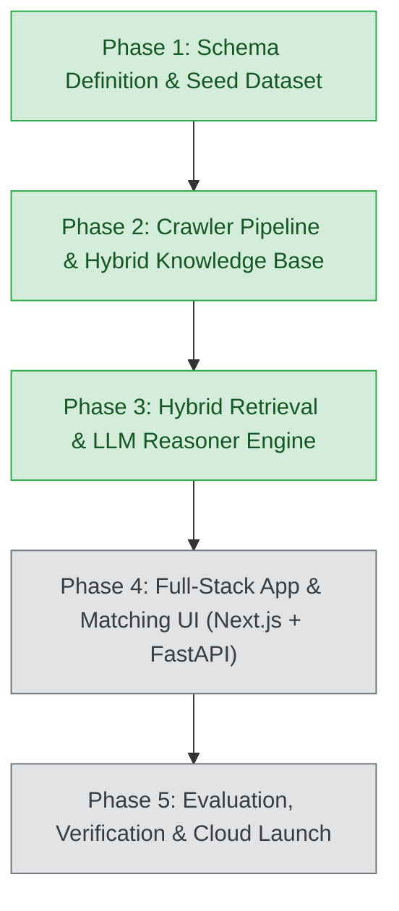

# Government Schemes Discovery & RAG Platform

An enterprise-grade, retrieval-augmented AI platform that matches businesses (MSMEs, Startups, Sole Proprietors, Large Enterprises) with central and state government schemes, subsidies, grants, and credit facilities.

---

## 1. Roadmap & Architecture Status



| Phase | Milestone | Status | Key Deliverables |
| :--- | :--- | :--- | :--- |
| **Phase 1** | Schema Definition & Seed Dataset | ✅ Complete | Pydantic Schemas (`BusinessProfile`, `GovernmentScheme`), 30 Flagship Seed Schemes, GST REG-06 Multimodal Parser, Stage 1 Deterministic Engine. |
| **Phase 2** | Crawler Pipeline & Knowledge Base Construction | ✅ Complete | Multi-portal Scrapers (MSME, Startup India, Jan Samarth, MyScheme), PDF Guideline Ingestion Engine, SQLite Knowledge Store, Dense Vector Index, `pipeline.py` CLI. |
| **Phase 3** | Hybrid Retrieval & Reasoner Engine | ✅ Complete | Reciprocal Rank Fusion (RRF), Cross-Encoder Reranker, LLM Eligibility Verification & Regulatory Document Gap Analysis Synthesizer. |
| **Phase 4** | Full-Stack App & Matching UI | ⏳ Next | Next.js 14 Document Upload Dashboard + FastAPI Backend. |
| **Phase 5** | Guardrails, Testing & Launch | ⏳ Planned | Hallucination Guardrails, PII Masking, Production Deployment. |

---

## 2. Directory Structure

```text
government-schemes-rag/
├── pipeline.py                   # Unified Pipeline Runner (Crawl, Ingest, Index, Search, Phase 3 Reasoner)
├── cli.py                        # Interactive CLI demo for Phase 1 & Phase 3
├── requirements.txt              # Core project dependencies
├── README.md                     # Architecture and operational documentation
├── crawlers/                     # Multi-source scraper modules
│   ├── __init__.py
│   ├── base.py                   # BaseSchemeCrawler (Rate limiting, retries, dual live/offline fixture mode)
│   ├── msme_crawler.py           # MSME & DC-MSME portal scraper (ZED, PMS, Innovative, PMFME)
│   ├── startup_india_crawler.py  # Startup India scraper (SISFS, Section 80-IAC, CGSS, SAMRIDH)
│   ├── jansamarth_crawler.py     # Jan Samarth credit scraper (PMEGP, Mudra, Stand-Up India, CGTMSE)
│   └── myscheme_crawler.py       # MyScheme unified central & state scraper (CMEGP-MH, PLI, SPECS)
├── parsers/
│   ├── __init__.py
│   ├── gst_parser.py             # Form GST REG-06 Multimodal Prompt & text parser
│   └── pdf_guidelines_parser.py  # PDF guidelines parser (Text chunking, eligibility & subsidy extraction)
├── knowledge_base/               # Persistent storage & hybrid search engine
│   ├── __init__.py
│   ├── storage.py                # SQLite Knowledge Store (schemes, scheme_documents, crawl_history)
│   ├── normalizer.py             # Schema normalizer & deduplicator against GovernmentScheme model
│   └── vector_store.py           # Dense TF-IDF / Cosine Vector Store + metadata pre-filtering
├── schemas/
│   ├── __init__.py
│   ├── business_profile.py       # Pydantic model for BusinessProfile (GST/Udyam digital twin)
│   ├── government_scheme.py      # Authoritative Pydantic model for GovernmentScheme
│   └── reasoner_schema.py        # Phase 3 schemas: DocumentGapItem, ClauseCitation, FullReasoningReport
├── engine/
│   ├── __init__.py
│   ├── matcher.py                # Stage 1 Deterministic Pre-Filtering Engine
│   ├── retriever.py              # Stage 2 Hybrid Multi-Channel Retriever with Reciprocal Rank Fusion (RRF)
│   ├── reranker.py               # Stage 2.5 Cross-Encoder Contextual Reranker with explainable factors
│   ├── reasoner.py               # Stage 3 LLM Eligibility Verifier & Document Gap Analysis Synthesizer
│   └── pipeline_phase3.py        # Unified Phase 3 Orchestrator & Report Generator
├── data/
│   ├── gst_state_codes.json      # GSTIN 2-digit state code mapping (01 to 38)
│   ├── schemes_seed.json         # 30 curated flagship schemes golden benchmark
│   ├── schemes_knowledge.db      # SQLite relational database (schemes + chunks + crawl history)
│   └── schemes_vector_index.json # Dense vector index and vocabulary
├── samples/
│   ├── sample_gst_certificates.json # Mock GST certificates for diverse sectors/states
│   ├── sample_1_report.md        # Sample generated Markdown gap analysis report
│   ├── create_sample_pdfs.py     # Sample PDF guidelines generator
│   └── guidelines/               # Generated test guideline circulars (PMEGP, ZED)
└── tests/
    ├── test_phase1.py            # Automated tests for Phase 1 schemas and deterministic matcher (6 tests)
    ├── test_phase2.py            # Automated tests for Phase 2 crawlers, PDF parser, SQLite, & Vector Store (9 tests)
    └── test_phase3.py            # Automated tests for Phase 3 Hybrid RRF, Cross-Encoder, & Reasoner (8 tests)
```

---

## 3. Phase 3 Features & Components

### 3.1 Advanced Hybrid Retrieval Engine (`engine/retriever.py`)
- **Multi-Channel Candidate Generation**:
  - **Deterministic Metadata Filtering**: Evaluates hard jurisdictional constraints (State exclusion, legal entity exclusions, manufacturing/services requirements).
  - **Dense Semantic Retrieval**: Computes cosine similarity between applicant profile intent vectors and scheme document / circular embeddings.
  - **Sparse Lexical Scoring**: Executes BM25-style term-frequency scoring over titles, nodal ministries, keywords, and eligibility clauses.
- **Reciprocal Rank Fusion (RRF)**:
  - Fuses dense and lexical ranks via $RRF(d) = \frac{w_{dense}}{k + r_{dense}(d)} + \frac{w_{sparse}}{k + r_{sparse}(d)}$ with $k=60$.
  - Soft priority boosts for state-specific matches, sector alignment, woman-owned units, and DPIIT-recognized startups.
  - Automatically fetches official guideline circular chunks associated with candidate schemes.

### 3.2 Cross-Encoder Contextual Reranker (`engine/reranker.py`)
- Evaluates the joint cross-attentive interaction between applicant attributes and scheme rules:
  - **Regulatory Feasibility (0 - 30 pts)**: State jurisdiction, constitutional form, business operational age, MSME tier.
  - **Operational & Sectoral Fit (0 - 30 pts)**: Manufacturing vs service operations, sector alignment, HSN/SAC match.
  - **Affirmative Policy Priority (0 - 25 pts)**: Woman-owned priority, SC/ST social category, DPIIT startup priority.
  - **Official Circular Passage Relevance (0 - 15 pts)**: Clause-level overlap with ingested PDF circular chunks.
- Computes **Rank Shift Tracking** ($Rank_{initial} \to Rank_{reranked}$) and explainable factor notes.

### 3.3 LLM Eligibility Reasoner & Document Gap Synthesizer (`engine/reasoner.py`)
- **Authoritative Deliberation**:
  - Classifies candidates into `Eligible`, `Conditionally Eligible`, or `Ineligible` with confidence scores and granular pass/fail bullet points.
- **Financial Benefit Quantum Calculator**:
  - Computes exact or estimated monetary assistance tailored to business metrics (e.g. 35% margin money subsidy on PMEGP up to ₹17.5 Lakh for rural women/SC-ST; 80% to 90% fee subsidy on ZED certification; ₹20 Lakh 100% grant on SISFS).
- **Automated Regulatory Document Gap Analysis**:
  - Audits applicant documents against mandatory checklists using the `DOCUMENT_REGULATORY_REGISTRY`.
  - Flags status (`Available`, `Missing`, `Action Required`) with official issuing authorities (e.g., Udyam Portal, Chartered Accountant, SPCB, SDM/Tehsildar), SLAs in working days, and step-by-step resolution guidance.
- **Official Circular Citations**:
  - Grounds every recommendation in official circular text (citing document name, page numbers, and exact excerpts).
- **Dual Execution Mode**:
  - **Gemini API Mode**: Leverages Gemini 2.5 / 1.5 Flash for dynamic structured JSON reasoning when `GEMINI_API_KEY` is present.
  - **Deterministic Grounded Fallback**: Provides high-precision, zero-hallucination rule-grounded synthesis in offline or CI/CD test environments.

---

## 4. Quickstart & Verification

### Run All Automated Test Suites (23 Total Tests)
```powershell
# Run Phase 1 Tests (6 tests)
python tests/test_phase1.py

# Run Phase 2 Tests (9 tests)
python tests/test_phase2.py

# Run Phase 3 Tests (8 tests)
python tests/test_phase3.py
```
*Expected Result: `OK` across all 23 tests.*

### Running Phase 3 Reasoner CLI

#### 1. Deliberate on a Business Profile (Sample 1: Tech Startup)
```powershell
python pipeline.py --analyze-profile 1 --top-k 4
```

#### 2. Deliberate on Sample 2 (Food Processing Sole Proprietorship)
```powershell
python pipeline.py --analyze-profile 2 --top-k 3
```

#### 3. Deliberate on Sample 3 (Textile Manufacturing LLP)
```powershell
python pipeline.py --analyze-profile 3 --top-k 4
```

#### 4. Export Markdown & JSON Reports
```powershell
python pipeline.py --analyze-profile 1 --export-markdown samples/sample_1_report.md --export-json samples/sample_1_report.json
```

#### 5. Run via Interactive CLI
```powershell
python cli.py --sample 1 --phase3
```

---

## 5. Next Steps: Phase 4
With Phase 3 complete (Hybrid Retrieval, Contextual Cross-Encoder Reranking, and LLM Eligibility & Document Gap Deliberation), the backend reasoning engine is fully operational. We are now prepared for **Phase 4: Full-Stack App & Matching UI (Next.js 14 + FastAPI)**.
