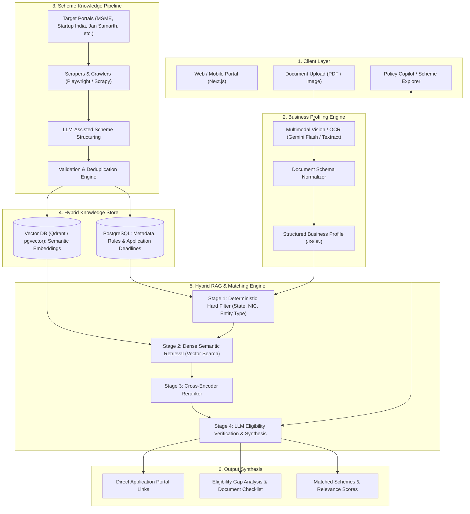
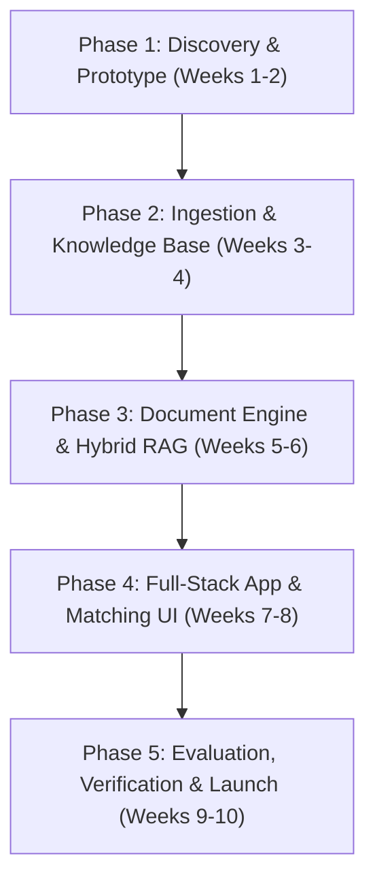

# Architectural Blueprint & Implementation Plan: RAG-Powered Government Schemes Discovery Platform

## 1. Executive Summary & Objective

The goal is to engineer an enterprise-grade, retrieval-augmented AI platform that matches businesses (MSMEs, Startups, Sole Proprietors, Large Enterprises) with central and state government schemes, subsidies, grants, and credit facilities.

The core differentiator of this system is **document-driven automatic profiling**:
Instead of forcing users to fill out complex 30-field questionnaires, the user uploads their business registration document (e.g., GST Registration Certificate `Form GST REG-06`, Udyam Registration, or Incorporation Certificate). The system extracts the profile, deterministically filters the policy universe, semantically retrieves matching schemes, and synthesizes an eligibility report with actionable application roadmaps.

---

## 2. End-to-End Architecture



---

## 3. Business Document Ingestion & Profiling Engine

### 3.1 Document of Primary Focus: GST Certificate (`Form GST REG-06`)
The GST Registration Certificate is a standardized document issued across India containing high-signal metadata:

| Extracted Field | GST Certificate Source | Scheme Matching Utility |
| :--- | :--- | :--- |
| **GSTIN** | Header / Registration Details | State code (first 2 digits), PAN verification |
| **Legal & Trade Name** | Field 1 & 2 | Entity identification and branding |
| **Constitution of Business** | Field 3 | Proprietorship, Partnership, Private Limited, LLP, Public Ltd (critical for eligibility) |
| **Principal Place of Business** | Field 4 | State, District, PIN code (filters State vs. Central schemes) |
| **Date of Registration / Liability** | Field 5 | Age of business (crucial for Startup India < 10 yrs, early-stage grants) |
| **Nature of Business / Activities** | Annexure B (Goods / Services) | HSN / SAC codes determining Manufacturing vs. Service vs. Trading |

### 3.2 Processing Pipeline
1. **Document Validation & Sanitization**:
   - Check file format (PDF, PNG, JPEG), file size, resolution, and malware scan.
   - PII masking if required (masking PAN/Aadhaar numbers in unencrypted storage).
2. **Vision-Language Parsing**:
   - Use high-fidelity multimodal processing (e.g., Gemini Flash with structured JSON output schema) or a two-step OCR (`pytesseract` / `AWS Textract` + LLM structurer).
3. **Derived Profile Schema**:
```json
{
  "business_profile": {
    "gstin": "27AAACG0000A1Z5",
    "state_code": "27",
    "state_name": "Maharashtra",
    "entity_type": "Private Limited Company",
    "date_of_registration": "2021-04-15",
    "business_age_years": 5.5,
    "category": "Manufacturing",
    "hsn_sac_codes": ["8471", "8504"],
    "nic_broad_category": "Electronic Hardware & Machinery",
    "turnover_bracket": "Unknown (Prompts user if necessary)",
    "msme_tier": "Micro"
  }
}
```

> [!TIP]
> While GST does not explicitly state annual turnover, the system can prompt the user with a single optional slider: *"What is your approximate annual turnover?"* (e.g., `< ₹1 Cr`, `₹1-5 Cr`, `₹5-50 Cr`) to immediately resolve MSME category classification (Micro, Small, Medium).

---

## 4. Data Sourcing & Scheme Corpus Strategy

### 4.1 Target Source Matrix & Focus Areas

| Portal | Target Schemes / Categories | Key Focus for Extractor |
| :--- | :--- | :--- |
| **`msme.gov.in`** | ZED Certification, CLCSS, PMS, Incubators, Tool Rooms | Capital subsidies, green certifications, technology upgrades |
| **`dcmsme.gov.in`** | Development Commissioner schemes, Cluster Development, IPR | Micro/cottage cluster grants, patent reimbursements |
| **`startupindia.gov.in`** | DPIIT Recognition, SISFS (Seed Fund), FFS, Tax 80-IAC | Early-stage equity/debt, incubators, patent fast-tracking |
| **`jansamarth.in`** | PMEGP, Mudra Loans, Stand-Up India, Agri Infrastructure Fund | Credit-linked capital subsidies, bank loan guarantee linkages |
| **`digitalindia.gov.in`** | PLI Schemes, SPECS, TIDE 2.0, MeitY SAMRIDH | Electronics, IT/ITeS, deeptech and software grants |
| *Bonus*: **`myscheme.gov.in`** | Unified central and state repository | Reference benchmark for comprehensive category classification |

### 4.2 Scraping & Content Ingestion Pipeline
1. **Web Scraper & Crawler**:
   - Framework: **Playwright** (for dynamic JavaScript tables and pagination) + **BeautifulSoup** for static pages.
   - Document Downloader: Automated download and parsing of official PDF brochures, operational guidelines, and gazette notifications.
2. **Schema Normalization (LLM-Assisted)**:
   Raw scraped pages are converted into a standardized JSON scheme model:
   - `scheme_id`: Unique slug.
   - `scheme_name`: Official title.
   - `ministry`: Nodal ministry/department.
   - `jurisdiction`: Central or State (with specific state code).
   - `target_industries`: List of NIC / sector tags.
   - `eligible_entity_types`: `["Proprietorship", "Private Limited", "LLP", ...]`
   - `eligibility_criteria`: Bulleted conditions (age, turnover caps, gender/caste affirmative mandates).
   - `benefits`: Financial subsidy, collateral-free credit, tax waiver, skill training.
   - `application_mode`: Online URL / Offline nodal agency.
   - `required_documents`: GST, Udyam, ITR, Project Report, etc.
   - `status`: Active / Expired / Coming Soon.

---

## 5. Knowledge Base & Hybrid Retrieval (RAG) Architecture

A purely semantic vector search is **insufficient** for policy eligibility because government schemes have strict Boolean eligibility criteria. If a scheme requires a business to be located in Odisha or registered within 3 years, a semantic search might match the industry keywords while ignoring the hard disqualifiers.

### 5.1 Hybrid Search Pipeline (Filter-First RAG)

```mermaid
flowchart LR
    Query["User Business Profile + Query"] --> PreFilter["Stage 1: SQL Pre-Filter"]
    PreFilter -- "Jurisdiction, Entity Type, Age" --> Candidates["Pre-Filtered Schemes Subset"]
    Candidates --> VectorSearch["Stage 2: Dense Semantic Search"]
    VectorSearch --> Reranker["Stage 3: Cross-Encoder Rerank"]
    Reranker --> TopK["Top 5-10 High Match Schemes"]
    TopK --> LLM["Stage 4: LLM Gap Analysis & Reasoning"]
```



1. **Stage 1: Deterministic Filtering (SQL/Metadata)**:
   - Rule: `(jurisdiction == 'Central' OR state == profile.state) AND (entity_type IN scheme.eligible_entities) AND (scheme.max_business_age >= profile.age)`
   - Drastically narrows down 2,000+ schemes to ~50-100 valid candidates.
2. **Stage 2: Dense Semantic Search (Vector DB)**:
   - Embed business activities (HSN descriptions, products, keywords) against scheme description and objectives embeddings.
   - Embeddings Model: `text-embedding-3-large`, `BGE-M3` (supports multilingual nuances), or `gemini-embedding-exp`.
3. **Stage 3: Cross-Encoder Reranking**:
   - Use `cohere-rerank` or `bge-reranker-large` to score similarity between the user's detailed profile and candidate schemes.
4. **Stage 4: LLM Eligibility Verification & Response Synthesis**:
   - Grounded LLM prompt with strict temperature (0.0) evaluating:
     - *Why it matches*
     - *Potential eligibility gaps*
     - *Step-by-step application instructions*

---

## 6. Recommended Technology Stack

| Layer | Recommended Technology | Justification |
| :--- | :--- | :--- |
| **Frontend UI** | **Next.js 14 (App Router) + Tailwind CSS + shadcn/ui** | Fast, responsive, server-side rendering, clean professional UI for document upload & search. |
| **Backend API** | **FastAPI (Python 3.11+)** | Native async support, seamless integration with AI/ML libraries, high throughput. |
| **Document OCR/Vision**| **Gemini 2.0 Flash / Multimodal API** | State-of-the-art native document reasoning, high OCR precision on Indian government documents and stamps. |
| **Vector Database** | **Qdrant** or **PostgreSQL with pgvector** | Robust hybrid filtering (payload filtering + cosine similarity in one query). |
| **Primary Database** | **PostgreSQL (Supabase or AWS RDS)** | Structured storage for user accounts, profiles, scraped schemes, application logs. |
| **Crawler / Ingestion**| **Playwright + Crawl4AI + Celery/Redis** | Robust handling of dynamic government portals, background queue management. |
| **LLM Orchestration** | **LangChain / LlamaIndex** | Document chunking, retrieval chains, hybrid search integration. |

---

## 7. Step-by-Step Implementation Roadmap



### Phase 1: Schema Definition & Seed Dataset (Weeks 1–2)
- Define standard schemas for:
  1. `BusinessProfile` (GST, Udyam fields).
  2. `GovernmentScheme` (Eligibility rules, benefits, documentation, links).
- Manually curate 30 top flagship schemes across MSME, Startup India, and Jan Samarth (PMEGP, Mudra, CGTMSE, SISFS, PLI) to act as the golden evaluation benchmark.
- Build a prototype GST Certificate parser using multimodal vision prompting.

### Phase 2: Crawler Pipeline & Knowledge Base Construction (Weeks 3–4)
- Implement scrapers for target portals (`msme.gov.in`, `dcmsme.gov.in`, `startupindia.gov.in`, `jansamarth.in`, `digitalindia.gov.in`).
- PDF parsing pipeline to extract scheme guidelines and notification circulars.
- Store structured metadata in PostgreSQL and chunked embeddings in the Vector DB (Qdrant/pgvector).
- Set up weekly cron jobs to detect scheme updates and new notifications.

### Phase 3: Hybrid Retrieval & Eligibility Reasoner Engine (Weeks 5–6)
- Implement two-stage matching:
  - Boolean SQL Filter (Location, Entity Type, Age).
  - Semantic Vector Search + Reranker (Activity & HSN mapping).
- Build the Eligibility Evaluator prompt:
  - Compares parsed business JSON directly against scheme criteria.
  - Outputs Match Confidence (High / Moderate / Low) + Checklist.

### Phase 4: Application Development & Chat Explorer (Weeks 7–8)
- Build Next.js user interface:
  - Drag-and-drop document upload (GST/Udyam).
  - Instant profile preview card with editable fields (e.g. user can adjust turnover or add certifications like ISO/ZED).
  - Ranked scheme dashboard with bookmarking and export to PDF.
  - Interactive "Scheme Assistant" chat widget for deep-dive questions (*"What collateral is required under CGTMSE?"*).
- Integrate FastAPI backend with user authentication and rate limiting.

### Phase 5: Guardrails, Testing & Launch (Weeks 9–10)
- **Hallucination Guardrails**: Enforce strict grounding (every scheme recommendation must cite the official source URL and scheme circular number).
- **Redaction & Privacy**: Implement zero-retention or client-side masking for sensitive PII.
- User acceptance testing with real MSME business owners and startup founders.
- Deploy infrastructure on cloud hosting (AWS / GCP / Railway).

---

## 8. Critical Challenges & Mitigation Strategies

1. **Hallucination in Subsidies and Eligibility**:
   - *Risk*: AI promising an entrepreneur an 80% subsidy that does not exist or has expired.
   - *Mitigation*: The LLM should never invent criteria. All eligibility clauses must be rendered directly from stored structured JSON; the LLM is only used to explain the fit and cross-reference documents.
2. **Document Variation and Scanned/Stamped Quality**:
   - *Risk*: Scanned, skewed, low-res GST certificates with watermarks or notary stamps.
   - *Mitigation*: Use vision-based LLM parsing (Gemini Multimodal) instead of basic OCR, and provide an instant "Profile Confirmation" modal where the user can verify/edit detected fields before search.
3. **Dynamic State Policies**:
   - *Risk*: State-specific schemes (e.g., Gujarat Industrial Policy, Karnataka IT Policy) vary widely and update periodically.
   - *Mitigation*: Start with Central government schemes and top industrial states (Maharashtra, Karnataka, Gujarat, Tamil Nadu), expanding state-level scrapers progressively.
4. **Data Privacy & Compliance**:
   - *Risk*: Handling sensitive GSTIN and business owner data.
   - *Mitigation*: Provide explicit disclaimer that uploaded documents are parsed ephemerally in-memory and not stored permanently unless the user creates an encrypted profile.

---

## 9. Immediate Next Steps

1. **Approve Schema & Scope**: Confirm target initial batch of schemes (e.g., MSME + Startup India + Jan Samarth).
2. **Create Project Directory**: Set up project repository inside the antigravity workspace.
3. **Prototype Ingestion & Parser**: Run sample test scripts against 3-5 real GST certificates to validate parsing fidelity.
