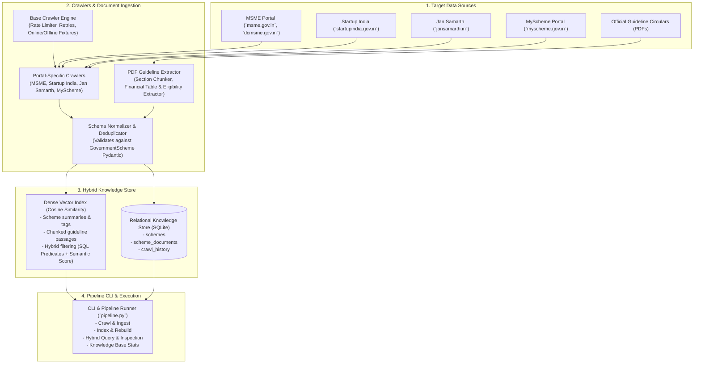

# Phase 2 Implementation Plan: Crawler Pipeline & Knowledge Base Construction

This document outlines the detailed architecture, component design, and implementation steps for **Phase 2: Crawler Pipeline & Knowledge Base Construction** of the Government Schemes Discovery & RAG Platform.

---

## 1. Phase 2 Scope & Objectives

Building upon Phase 1 (Standard Schemas, 30 Curated Seed Schemes, GST REG-06 Parser, and Stage-1 Deterministic Filter Engine), Phase 2 creates the automated ingestion and retrieval layer:

---

## 2. Component Breakdown

### 2.1 Multi-Source Crawler Pipeline (`crawlers/`)
- **`crawlers/base.py`**:
  - `BaseSchemeCrawler`: Abstract base crawler featuring polite rate limiting, retry backoff, custom headers / User-Agent rotation.
  - Dual Mode Operation:
    - **Live Fetch**: Connects to target government portals using `httpx`/`requests` and `BeautifulSoup4`.
    - **Offline Snapshot Fixtures**: Built-in resilient snapshot fallback so crawlers, pipelines, and test suites run reproducibly even in air-gapped environments or when government portals have temporary downtime.
- **`crawlers/msme_crawler.py`**: Scrapes and structures MSME schemes (ZED Certification, CLCSS, MSME Champions, PMS, PMFME, Incubation).
- **`crawlers/startup_india_crawler.py`**: Scrapes Startup India programs (SISFS, Section 80-IAC Tax Exemption, Fund of Funds, CGSS, MeitY SAMRIDH).
- **`crawlers/jansamarth_crawler.py`**: Scrapes credit-linked subsidy schemes (PMEGP, Mudra Shishu/Kishore/Tarun, Stand-Up India, Agri Infrastructure Fund).
- **`crawlers/myscheme_crawler.py`**: Standardizes categorized scheme data from central and state repositories.

### 2.2 PDF Guideline & Notification Circular Ingestion (`parsers/pdf_guidelines_parser.py`)
- Reads official government operational guideline circulars (PDFs).
- Extracts sections:
  - Policy Objectives
  - Eligibility & Disqualification Rules
  - Financial Assistance Caps & Subsidy Percentages
  - Mandatory Document Checklist
  - Application Workflow & Nodal Agency
- Automatically creates document chunks for granular vector search citations.

### 2.3 Knowledge Base & Hybrid Retrieval Store (`knowledge_base/`)
- **`knowledge_base/storage.py`**:
  - SQLite relational repository storing full structured `GovernmentScheme` models.
  - Relational tables: `schemes`, `scheme_documents` (guideline chunks), `crawl_history` (audit runs).
  - ACID transactions, status filters, ministry indexing, and state applicability queries.
- **`knowledge_base/vector_store.py`**:
  - Semantic vector indexing for schemes and guideline chunks.
  - Fast, self-contained dense vector embedding & cosine similarity search engine (zero external cloud lock-in, with pluggable Gemini Embedding API adapter).
  - Hybrid Search: Evaluates deterministic metadata criteria (State, Constitution, MSME Tier) combined with semantic relevance ranking.
- **`knowledge_base/normalizer.py`**:
  - Validates all crawler/PDF inputs against the strict `GovernmentScheme` Pydantic model from Phase 1.
  - Deduplication: merges incoming records with existing schemes by slug and canonical title.
  - Computes data completeness scores.

### 2.4 Orchestration & CLI (`pipeline.py`)
- Unified CLI interface supporting:
  - `--crawl [msme,startup_india,jansamarth,myscheme,all]`
  - `--ingest-pdf <file_path> [--scheme-id <id>]`
  - `--build-index`: Ingests Phase 1 seed schemes (`schemes_seed.json`) + scraped schemes into SQLite & Vector Index.
  - `--query "<text>"` with optional `--state`, `--entity`, `--sector`, `--tier` filters.
  - `--stats`: Summarizes total schemes, guideline documents, categories, and crawl audits.

### 2.5 Verification & Automated Test Suite (`tests/test_phase2.py`)
- Unit tests for each crawler (live & offline fallback).
- PDF parsing test on sample guideline circulars.
- Schema normalization and deduplication tests.
- SQLite persistence and transaction integrity tests.
- Hybrid vector search accuracy tests.
- End-to-end integration test of the entire pipeline.

---

## 3. Implementation Steps

1. **Setup Directory Structure & Updated Requirements**:
   - Create `crawlers/`, `knowledge_base/`, `samples/guidelines/`.
   - Update `requirements.txt` with `beautifulsoup4`, `httpx`, `requests`, `pypdf`.
2. **Implement Base Crawler & Portal Crawlers**:
   - `crawlers/base.py`, `msme_crawler.py`, `startup_india_crawler.py`, `jansamarth_crawler.py`, `myscheme_crawler.py`.
3. **Implement PDF Guidelines Parser**:
   - `parsers/pdf_guidelines_parser.py` and test guideline generator.
4. **Implement Knowledge Base & Vector Store**:
   - `knowledge_base/storage.py`, `knowledge_base/vector_store.py`, `knowledge_base/normalizer.py`.
5. **Implement Pipeline Orchestrator**:
   - `pipeline.py`.
6. **Implement Test Suite & Verification**:
   - `tests/test_phase2.py`.
   - Update `README.md` and verify all tests pass.
